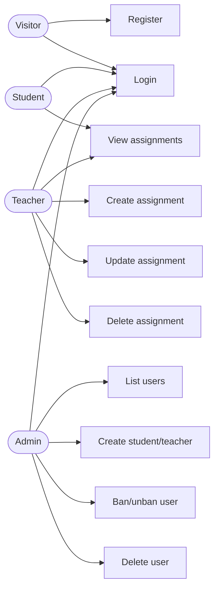
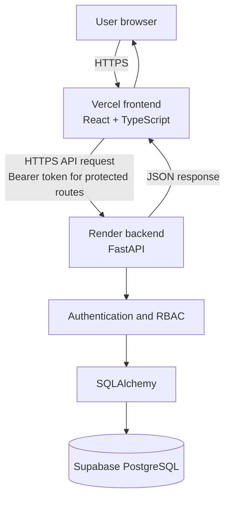
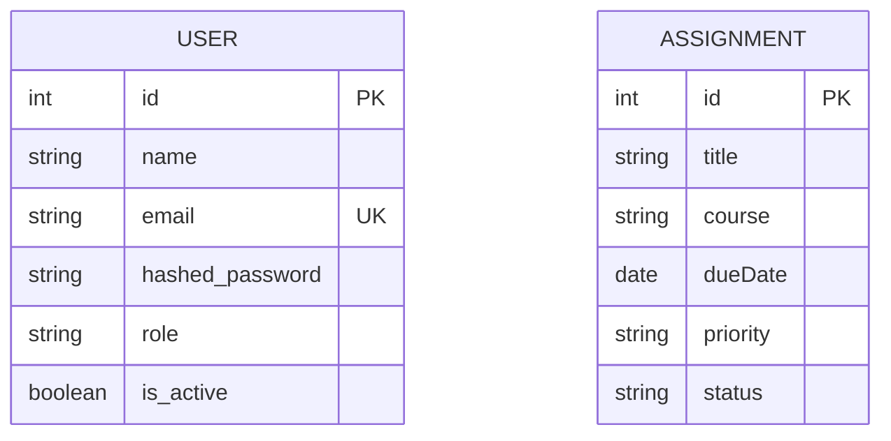
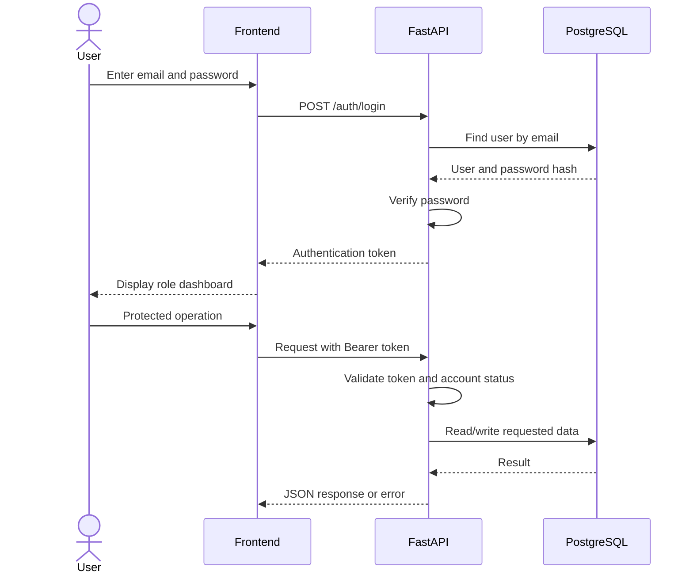
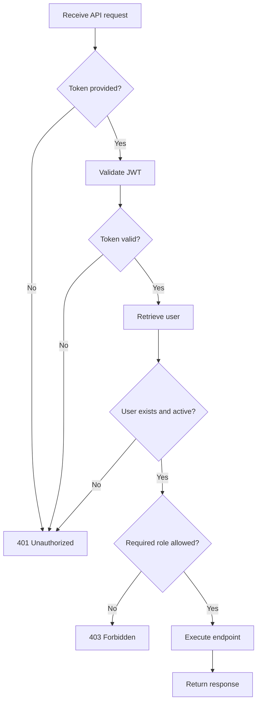
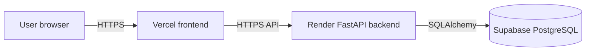

<p align="center">

**INDEPENDENT UNIVERSITY, BANGLADESH**  
**Department of Computer Science & Engineering**  
**CSE309 – Web Application & Internet**

# FINAL PROJECT SUBMISSION REPORT

## Student Assignment Tracker

**Submitted by:** Muhammad Sanowarul Islam Fahim  
**Student ID:** 2420864
**Section:** 05 
**Team Number:** Individual Project

**Project Title:** Student Assignment Tracker  
**Vercel URL:** https://student-assingment-tracker-nx17mw8mk-fahimkhan24.vercel.app/  
**GitHub Repository:** https://github.com/fahimkhan24/Student_Assingment_Tracker

**Submitted To:**  
**Sayef Reyadh**  
Adjunct Lecturer  
Department of Computer Science & Engineering  
Independent University, Bangladesh

**Semester:** Autumn 2026  
**Date of Submission:** 28 November 2026

</p>

---

> **Important:** This report preserves the original template's Part A–E structure, headings, and requirement categories. It describes the implementation established during development. Features marked **Not implemented / Not verified** must not be presented as completed. Fill in personal details, add real screenshots, verify test results, and insert actual GitHub issue/PR links before submission.

# Table of Contents

- [1. Executive Summary](#1-executive-summary)
- [Part A. Product Requirements (PRD)](#part-a-product-requirements-prd)
- [Part B. Software Requirements (SRS)](#part-b-software-requirements-srs)
- [Part C. Technical Design (TDD)](#part-c-technical-design-tdd)
- [Part D. Evidence: Screenshots of the Running Application](#part-d-evidence-screenshots-of-the-running-application)
- [Part E. Project Management and Conclusion](#part-e-project-management-and-conclusion)
- [Appendix. Test Accounts and Video Demo](#appendix-test-accounts-and-video-demo)

# 1. Executive Summary

## 1.1 Project overview

**Student Assignment Tracker** is a web application that helps students view and track academic assignments and allows teachers to manage assignment information. Assignment records contain a title, course, due date, priority, and status. The application provides signup, login, JWT-based authentication, and role-based access control for students, teachers, and administrators.

The frontend is developed with React and TypeScript. The backend uses Python and FastAPI. SQLAlchemy handles database operations, and the deployed application uses Supabase PostgreSQL for persistent storage. The frontend is hosted on Vercel and the backend on Render.

**Technology stack:** React + TypeScript + Vite + Tailwind CSS | Python + FastAPI | SQLAlchemy | Supabase PostgreSQL | Vercel | Render.

## 1.2 What was built since the mid assessment

- **JWT authentication:** Signup and login were implemented. The backend verifies passwords and issues a signed JWT after successful login. Refresh-token rotation, logout revocation, and session management have not been verified.
- **Role-based access control:** The application supports `student`, `teacher`, and `admin`. Backend role checks protect teacher and admin operations. Group permissions and detailed record-ownership rules have not been verified.
- **Admin dashboard:** The admin interface supports user listing, creating student/teacher accounts, banning/unbanning users, and deleting users. Activity logs, security analytics, bulk moderation, and CSV exports have not been verified.
- **Deployment:** The frontend was deployed to Vercel, the FastAPI backend to Render, and the production database was configured with Supabase PostgreSQL. Audit logging and brute-force protection have not been verified.

## 1.3 Live links

**Table 1: Project links**

| Resource | Link |
|---|---|
| GitHub repository | [Student_Assingment_Tracker](https://github.com/fahimkhan24/Student_Assingment_Tracker) |
| Vercel frontend | [Open application](https://student-assingment-tracker-nx17mw8mk-fahimkhan24.vercel.app/) |
| Render API | [Backend service](https://student-assingment-tracker.onrender.com/) |
| API health check | [Health endpoint](https://student-assingment-tracker.onrender.com/health) |
| API documentation | [FastAPI Swagger UI](https://student-assingment-tracker.onrender.com/docs) |
| Video demo | [Add 5–8 minute video link](#) |

Never include test-account passwords, JWTs, secret keys, or database connection strings in this Markdown file or anywhere in the GitHub repository.

---

# Part A. Product Requirements (PRD)

## A1. Problem Statement

Students receive assignments from different courses and need to remember assignment titles, course names, deadlines, priorities, and completion status. When this information is kept in different messages, documents, or personal notes, it can become difficult to track deadlines and identify which assignments are still pending.

Teachers also need a consistent way to create and maintain assignment information for students. If assignment details are communicated in different places, students may not always have the latest information. A centralized application can make assignment information easier to access and manage.

## A2. Users and Roles

**Table 2: Users and roles**

| Role | Who they are | Main tasks | What they must never be able to do |
|---|---|---|---|
| Visitor | Person not logged in | Open the application, signup, login | Access protected assignment or admin operations |
| Student | Authenticated student | View assignments and track their status | Create/update/delete assignments or use admin functions |
| Teacher | Authenticated teacher | Create, view, update, and delete assignments | Use admin-only user-management functions |
| Admin | Authorized administrator | List users, create student/teacher accounts, ban/unban and delete users | Grant privileges through public signup or bypass backend checks |
| Group member/owner | Not part of verified implementation | Not applicable | Group actions are unavailable |

The current project has three verified application roles: student, teacher, and admin. Group membership and group-owner permissions are not implemented or verified.

## A3. Goals and Success Measures

**Table 3: Goals and measures**

| ID | Goal | Success measure |
|---|---|---|
| G-01 | User registration | Valid signup creates a student account |
| G-02 | Authentication | Valid login returns an authentication token |
| G-03 | Role authorization | Student cannot perform teacher-only write operations |
| G-04 | Assignment management | Teacher can create, read, update, and delete assignments |
| G-05 | Admin management | Admin can list and manage user accounts using implemented actions |
| G-06 | Password protection | Passwords are stored as hashes, not plaintext |
| G-07 | Data persistence | Test record remains after backend restart, verified against PostgreSQL |
| G-08 | Deployment | Frontend loads and backend health endpoint responds |

Token revocation, brute-force lockout, ownership isolation, and group permissions require additional implementation or tests before they can be claimed.

## A4. Scope and Non-Goals

### In scope

- Student signup and login.
- Password hashing and JWT authentication.
- Student, teacher, and admin roles.
- Backend authentication and role checks.
- Assignment title, course, due date, priority, and status.
- Teacher assignment CRUD.
- Student assignment read access.
- Admin user listing, account creation, ban/unban, and deletion.
- SQLAlchemy database access.
- Supabase PostgreSQL production persistence.
- Vercel frontend and Render backend deployment.

### Out of scope / not implemented or not verified

- Refresh-token rotation and reuse detection.
- Server-side logout/session revocation and session listing.
- Profile update and change-password workflows.
- Group creation, membership, and permission assignment.
- Audit/activity log and security analytics.
- Brute-force login lockout and IP rate limiting.
- Bulk moderation and CSV export.
- Comprehensive automated API/security tests.
- Verified video demonstration.

### Assumptions and constraints

- Users access the application through a modern browser.
- Frontend and backend are deployed separately.
- `VITE_API_URL` configures the frontend API base URL.
- Backend secrets and database configuration are provided through environment variables.
- Supabase PostgreSQL is used for production; SQLite can be used as a local fallback.
- Hosting services may have cold starts and deployment limits.
- This is an individual CSE309 project.

## A5. User Stories

**Table 4: User stories**

| ID | User story |
|---|---|
| US-01 | As a visitor, I want to register a student account so that I can use the application. |
| US-02 | As a registered user, I want to log in so that I can access features allowed by my role. |
| US-03 | As an authenticated user, I want to retrieve my account information so that I can confirm which account is active. |
| US-04 | As a student, I want to view assignments so that I can see academic work available to me. |
| US-05 | As a student, I want to see assignment status and priority so that I can understand its progress. |
| US-06 | As a teacher, I want to create an assignment so that students can see its details. |
| US-07 | As a teacher, I want to update an assignment so that corrected information is available. |
| US-08 | As a teacher, I want to delete an assignment that is no longer required. |
| US-09 | As an admin, I want to list registered users so that I can manage accounts. |
| US-10 | As an admin, I want to create student and teacher accounts so that accounts can be provisioned. |
| US-11 | As an admin, I want to ban or unban a user so that account access can be controlled. |
| US-12 | As an admin, I want to delete a user account when required. |

Group-specific user stories are not included because group functionality is not part of the verified implementation.

---

# Part B. Software Requirements (SRS)

## B1. Introduction

This section specifies the functional and non-functional requirements of Student Assignment Tracker. It describes expected application behavior and provides requirement IDs that can be linked to implementation, tests, and screenshots.

**Intended readers:** Course instructor, project evaluator, developer, and future maintainer.

**Definitions**

| Term | Definition |
|---|---|
| JWT | JSON Web Token; a signed token used to carry authentication claims |
| Access token | Token sent with a protected API request to identify an authenticated user |
| Refresh token | Credential used to obtain a new access token; not verified in this project |
| RBAC | Role-Based Access Control; access is determined by user role |
| Role | User category such as student, teacher, or admin |
| Permission | Authorization rule that determines whether an operation is allowed |
| Audit log | Record of important actions; not verified in this project |

**References**

- [RFC 7519 – JSON Web Token](https://www.rfc-editor.org/rfc/rfc7519)
- [FastAPI documentation](https://fastapi.tiangolo.com/)
- [React documentation](https://react.dev/)
- [SQLAlchemy documentation](https://docs.sqlalchemy.org/)
- [OWASP ASVS](https://owasp.org/www-project-application-security-verification-standard/)

## B2. Functional Requirements

### Authentication requirements (FR-AUTH)

**Table 5: Authentication requirements**

| ID | Requirement | Status |
|---|---|---|
| FR-AUTH-01 | The system shall allow a visitor to register an account using the signup form. | Implemented |
| FR-AUTH-02 | Public signup shall create a student account and shall not accept a caller-selected teacher/admin role. | Implemented through schema validation; verify source |
| FR-AUTH-03 | The system shall allow a registered user to log in using email and password. | Implemented |
| FR-AUTH-04 | The system shall store a password hash rather than the original plaintext password. | Implemented |
| FR-AUTH-05 | The system shall issue a signed JWT after successful authentication. | Implemented |
| FR-AUTH-06 | The system shall provide an authenticated endpoint to retrieve the current user's information. | Implemented: `/auth/me` |
| FR-AUTH-07 | The system shall reject requests with missing or invalid authentication credentials on protected endpoints. | Implemented through dependencies |
| FR-AUTH-08 | The system shall reject an inactive/banned user when authentication checks the account. | Implemented according to development; verify live |
| FR-AUTH-09 | The system shall prevent public signup from assigning privileged roles through extra request fields. | Implemented through schema validation |
| FR-AUTH-10 | The system shall support refresh-token rotation and reject reuse of an old refresh token. | Not implemented / not verified |
| FR-AUTH-11 | The system shall revoke a server-side session on logout. | Not implemented / not verified |
| FR-AUTH-12 | The system shall list active sessions and allow individual session revocation. | Not implemented / not verified |
| FR-AUTH-13 | The system shall allow a user to update profile information. | Not implemented / not verified |
| FR-AUTH-14 | The system shall allow a user to change a password after verifying the current password. | Not implemented / not verified |
| FR-AUTH-15 | The system shall temporarily block login after repeated failed attempts. | Not implemented / not verified |
| FR-AUTH-16 | The system shall use a password pepper in addition to hashing. | Not verified; do not claim unless confirmed |

### Role-based access requirements (FR-RBAC)

**Table 6: RBAC requirements**

| ID | Requirement | Status |
|---|---|---|
| FR-RBAC-01 | The system shall support student, teacher, and admin roles. | Implemented |
| FR-RBAC-02 | The backend shall enforce role restrictions for protected operations. | Implemented |
| FR-RBAC-03 | A student shall be allowed to read assignment information. | Implemented by role design; verify live |
| FR-RBAC-04 | A student shall not be allowed to create, update, or delete assignments. | Implemented through teacher-only checks; test |
| FR-RBAC-05 | A teacher shall be allowed to create, update, and delete assignments. | Implemented |
| FR-RBAC-06 | An admin shall be allowed to access implemented user-management operations. | Implemented |
| FR-RBAC-07 | Public signup shall not allow a visitor to create an admin or teacher account. | Implemented |
| FR-RBAC-08 | The system shall enforce record ownership so users cannot access another user's private records. | Not verified |
| FR-RBAC-09 | The system shall support group creation and group membership. | Not implemented / not verified |
| FR-RBAC-10 | The system shall allow group owners to assign member permissions. | Not implemented / not verified |
| FR-RBAC-11 | The system shall restrict owner-only group actions to the group owner. | Not implemented / not verified |
| FR-RBAC-12 | The system shall prevent an administrator from changing their own role or banning another administrator. | Not verified |

### Administrator requirements (FR-ADM)

**Table 7: Admin requirements**

| ID | Requirement | Status |
|---|---|---|
| FR-ADM-01 | The system shall allow an admin to retrieve the user list. | Implemented |
| FR-ADM-02 | The system shall allow an admin to create student and teacher accounts. | Implemented |
| FR-ADM-03 | The system shall allow an admin to ban a user. | Implemented |
| FR-ADM-04 | The system shall allow an admin to unban a user. | Implemented |
| FR-ADM-05 | The system shall allow an admin to delete a user. | Implemented |
| FR-ADM-06 | The system shall prevent non-admin users from accessing admin-only endpoints. | Implemented |
| FR-ADM-07 | The system shall display overview statistics. | Not verified |
| FR-ADM-08 | The system shall support user search, filters, and pagination. | Not verified |
| FR-ADM-09 | The system shall display user details, sessions, and recent activity. | Not implemented / not verified |
| FR-ADM-10 | The system shall allow admins to change user roles. | Not verified |
| FR-ADM-11 | The system shall allow admins to revoke user sessions. | Not implemented / not verified |
| FR-ADM-12 | The system shall support bulk moderation actions. | Not implemented / not verified |
| FR-ADM-13 | The system shall maintain an activity log with filters. | Not implemented / not verified |
| FR-ADM-14 | The system shall display failed-login security analytics. | Not implemented / not verified |
| FR-ADM-15 | The system shall export filtered records as CSV. | Not implemented / not verified |
| FR-ADM-16 | The system shall record a reason for every ban action. | Not verified |

### Assignment domain requirements (FR-DOMAIN)

**Table 8: Assignment requirements**

| ID | Requirement | Status |
|---|---|---|
| FR-DOMAIN-01 | The system shall store an assignment title. | Implemented |
| FR-DOMAIN-02 | The system shall store the course name. | Implemented |
| FR-DOMAIN-03 | The system shall store an assignment due date. | Implemented |
| FR-DOMAIN-04 | The system shall support Low, Medium, and High priorities. | Implemented |
| FR-DOMAIN-05 | The system shall support Pending, In Progress, and Completed statuses. | Implemented |
| FR-DOMAIN-06 | The system shall allow an authorized teacher to create an assignment. | Implemented |
| FR-DOMAIN-07 | The system shall allow authorized users to retrieve assignment records. | Implemented by role design; verify routes |
| FR-DOMAIN-08 | The system shall allow an authorized teacher to update an assignment. | Implemented |
| FR-DOMAIN-09 | The system shall allow an authorized teacher to delete an assignment. | Implemented |
| FR-DOMAIN-10 | The system shall provide students with read access to assignment information. | Implemented by role design; verify live |

## B3. Non-Functional Requirements

**Table 9: Non-functional requirements**

| ID | Category | Requirement | Verification |
|---|---|---|---|
| NFR-SEC-01 | Security | Secrets shall be read from environment variables, not committed to source control. | Inspect repository and deployment settings |
| NFR-SEC-02 | Security | Passwords shall be stored as hashes. | Inspect hashing implementation/database |
| NFR-SEC-03 | Security | Authorization shall be checked by the backend. | Send restricted API request directly |
| NFR-SEC-04 | Security | Public signup shall not permit privileged role assignment. | Submit extra role field |
| NFR-PERF-01 | Performance | API requests should complete in reasonable time under normal demo usage. | Record actual response times |
| NFR-USE-01 | Usability | The frontend shall provide forms and role-appropriate dashboards. | Inspect deployed interfaces |
| NFR-USE-02 | Usability | The frontend should provide loading and error feedback. | Test API success and failure |
| NFR-REL-01 | Reliability | Production data shall persist in PostgreSQL. | Verify test record after restart |
| NFR-MAINT-01 | Maintainability | Database access shall be centralized through SQLAlchemy configuration. | Inspect backend database module |
| NFR-MAINT-02 | Maintainability | Dependencies shall be recorded in dependency files. | Inspect requirements and lockfile |

## B4. Roles and Permission Matrix

### Endpoint groups against roles

**Table 10: Endpoint groups by roles**

| Endpoint / operation | Visitor | Student | Teacher | Admin |
|---|---:|---:|---:|---:|
| Signup as student | Yes | No | No | No |
| Login | Yes | Yes | Yes | Yes |
| Read own profile (`/auth/me`) | No | Yes | Yes | Yes |
| Read assignments | No | Yes | Yes | Verify |
| Create assignment | No | No | Yes | Not established |
| Update assignment | No | No | Yes | Not established |
| Delete assignment | No | No | Yes | Not established |
| List users | No | No | No | Yes |
| Create student/teacher account | No | No | No | Yes |
| Ban/unban user | No | No | No | Yes |
| Delete user | No | No | No | Yes |
| Group operations | No | No | No | Not implemented |

The exact permission of an admin for assignment CRUD must be checked in the current backend. “Not established” avoids claiming an unverified permission.

### Group permissions

**Table 11: Group permissions**

| Group action | Create | Update | Assign | Current status |
|---|---|---|---|---|
| Create group | Not available | Not available | Not available | Not implemented |
| Update group | Not available | Not available | Not available | Not implemented |
| Add/remove members | Not available | Not available | Not available | Not implemented |
| Assign member permissions | Not available | Not available | Not available | Not implemented |
| Owner-only actions | Not available | Not available | Not available | Not implemented |

### Admin rules

**Table 12: Admin rules**

| Rule | Current status |
|---|---|
| Only admin can access user-management endpoints | Implemented |
| Public signup cannot create admin | Implemented |
| Admin can create student/teacher accounts | Implemented |
| Admin can ban/unban users | Implemented |
| Admin can delete users | Implemented |
| Admin cannot change own role | Not verified |
| Admin cannot ban another admin | Not verified |
| System admin has special group rights | Not applicable; groups not implemented |

## B5. Use Cases

### UC-01: Log in

- **Actor:** Student, teacher, or admin.
- **Preconditions:** Account exists and is active.
- **Main flow:**
  1. User opens the login page.
  2. User enters email and password.
  3. Frontend sends the request to `/auth/login`.
  4. Backend retrieves the account and verifies the password hash.
  5. Backend issues a signed JWT.
  6. Frontend stores authentication state and displays the appropriate interface.
- **Alternative/error flows:** Invalid credentials are rejected; invalid input is rejected by validation; inactive users should be rejected.
- **Postcondition:** User is authenticated.
- **Note:** Refresh-token rotation is not verified.

### UC-02: Create a record (assignment)

- **Actor:** Teacher.
- **Preconditions:** Teacher is authenticated.
- **Main flow:**
  1. Teacher opens the assignment form.
  2. Teacher enters title, course, due date, priority, and supported fields.
  3. Frontend sends the request with the token.
  4. Backend validates authentication and teacher role.
  5. Backend validates and stores the assignment.
  6. Frontend refreshes the assignment list.
- **Alternative/error flows:** Invalid data is rejected; missing/invalid token produces an authentication error; a student is denied a teacher-only write action.
- **Postcondition:** Assignment is stored.

### UC-03: Change a member's permissions

- **Actor:** Group owner.
- **Preconditions:** A group and members exist.
- **Status:** Not available because group creation, membership, and permission assignment are not implemented or verified.

### UC-04: A denied action

- **Actor:** Student.
- **Preconditions:** Student is authenticated.
- **Main flow:**
  1. Student attempts a teacher-only assignment write operation.
  2. Backend validates the token.
  3. Backend retrieves the current user.
  4. Backend checks the required role.
  5. Backend rejects the request because the user is not a teacher.
- **Alternative/error flows:** Missing/invalid credentials should produce 401; a valid user without the required role should receive 403.
- **Postcondition:** No unauthorized write is performed.

### UC-05: Ban a user

- **Actor:** Admin.
- **Preconditions:** Admin is authenticated and target user exists.
- **Main flow:**
  1. Admin opens user management.
  2. Admin selects a user and chooses ban.
  3. Frontend sends the admin request.
  4. Backend verifies admin authorization.
  5. Backend changes the user's active state.
  6. Frontend refreshes the user list.
- **Alternative/error flows:** Non-admin requests are rejected; unknown users cannot be updated; inactive users should be rejected by later authentication checks.
- **Postcondition:** Target account becomes inactive.
- **Status:** Ban/unban was developed; verify the live behavior.

### UC-06: Read the audit log

- **Actor:** Admin.
- **Status:** Not available because an audit-log feature has not been established in the current implementation.

### Use-case diagram

**Figure 1: Main application use cases**



## B6. Acceptance Criteria

**Table 13: Acceptance criteria**

| ID | Given | When | Then |
|---|---|---|---|
| AC-01 | Visitor provides valid signup details | Signup submitted | Student account is created |
| AC-02 | Visitor includes privileged role in signup | Request submitted | Extra field is rejected |
| AC-03 | Active user provides valid credentials | User logs in | Token is returned |
| AC-04 | Student is authenticated | Student attempts teacher-only write | Backend denies request |
| AC-05 | Teacher is authenticated | Teacher creates valid assignment | Assignment is saved |
| AC-06 | Admin is authenticated | Admin lists users | User list is returned |
| AC-07 | Admin bans a user | Banned user makes protected request | Backend rejects inactive account |
| AC-08 | Non-admin calls admin endpoint | Request processed | Backend denies request |
| AC-09 | User presents expired token | Protected endpoint called | 401 expected; verify test |
| AC-10 | User presents tampered token | Protected endpoint called | Token rejected; verify test |
| AC-11 | User accesses another user's private record | Request processed | Ownership check should deny; not verified |
| AC-12 | Group member lacks permission | Restricted group action attempted | 403 expected; group feature not implemented |
| AC-13 | Admin attempts to ban another admin | Request processed | Should be rejected if rule implemented; not verified |
| AC-14 | User repeatedly submits wrong passwords | Login attempts processed | Lockout expected only if implemented; not verified |

## B7. Traceability Matrix

**Table 14: Requirement, endpoint/screen, test, screenshot**

| Requirement | Endpoint / screen | Test | Evidence |
|---|---|---|---|
| FR-AUTH-01/02 | Signup, `/auth/signup` | Register student; submit extra role field | S1 |
| FR-AUTH-03/05 | Login, `/auth/login` | Valid/invalid login | S1 |
| FR-AUTH-06 | `/auth/me` | Call with valid token | S2 |
| FR-AUTH-07/08 | Protected endpoints | Missing/invalid token and inactive account | S7/S9 |
| FR-RBAC-01/02 | Backend role dependencies | Test student/teacher/admin access | S6 |
| FR-RBAC-03/04 | Student dashboard and assignment API | Student read and denied write | S2/S6 |
| FR-RBAC-05 | Teacher dashboard/API | Create/update/delete as teacher | S2 |
| FR-ADM-01/02 | Admin dashboard/user API | List and create user | S10 |
| FR-ADM-03/04 | Admin user management | Ban and unban test user | S9/S13 |
| FR-ADM-05 | Admin user management | Delete test user | S10 |
| FR-DOMAIN-01–05 | Assignment dashboard | Verify assignment fields | S2 |
| NFR-SEC-01 | Environment configuration | Inspect repository and deployment | S19 |
| NFR-REL-01 | Supabase PostgreSQL | Verify persistence after restart | S13 |
| Deployment | Vercel, Render, `/docs` | Open live services | S18/S20 |

---

# Part C. Technical Design (TDD)

## C1. Technology Stack

**Table 15: Technology stack**

| Component | Technology | Version / link | Reason |
|---|---|---|---|
| Frontend | React | Verify `package-lock.json` | Component-based interface |
| Frontend language | TypeScript | Verify lockfile | Static typing |
| Build tool | Vite | Verify lockfile | Development and production build |
| Styling | Tailwind CSS | Tailwind v4 setup; verify lockfile | Utility-based styling |
| Backend | FastAPI | `fastapi[standard]`; verify exact version | Python REST API |
| ORM | SQLAlchemy | Verify requirements | Database models and queries |
| Database | PostgreSQL | Supabase-hosted | Persistent relational storage |
| Local database | SQLite | Local fallback | Development |
| PostgreSQL driver | psycopg | Verify requirements | PostgreSQL connectivity |
| Password hashing | pwdlib / Argon2 configuration | Verify requirements and source | Password hashing |
| JWT library | PyJWT | Verify requirements and source | JWT handling |
| Frontend hosting | Vercel | Hosted service | Frontend deployment |
| Backend hosting | Render | Hosted service | API deployment |
| Database hosting | Supabase | Hosted service | PostgreSQL persistence |

Replace version notes with exact versions from dependency files. Do not guess versions.

## C2. System Architecture

**Figure 2: System architecture**



### Architecture explanation

1. The browser loads the React application from Vercel.
2. The frontend sends HTTPS API requests to the FastAPI backend on Render.
3. Protected requests include the authentication token in the authorization header.
4. FastAPI validates authentication and checks the user's role.
5. SQLAlchemy performs database operations.
6. The backend reads and writes data in Supabase PostgreSQL.
7. The backend returns JSON responses to the frontend.

An audit-log service and refresh-cookie flow are not shown because they have not been verified. The API backend is hosted on Render, not Vercel.

## C3. Backend and Frontend Structure

The following is a representative tree based on the project structure established during development. Compare it with the final GitHub repository and correct any filename differences.

### Backend folder tree

```text
backend/
├── app/
│   ├── main.py
│   ├── database.py
│   ├── models.py
│   ├── schemas.py
│   ├── security.py
│   └── auth.py
├── create_admin.py
├── requirements.txt
└── .env                 # Local only; do not commit
```

| File/folder | Responsibility |
|---|---|
| `app/main.py` | Creates FastAPI application, configures CORS/middleware, registers routes |
| `app/database.py` | SQLAlchemy engine, session factory, and database base |
| `app/models.py` | Database models such as User and Assignment |
| `app/schemas.py` | Request and response validation |
| `app/security.py` | Password hashing and JWT functions |
| `app/auth.py` | Current-user and role authorization dependencies |
| `create_admin.py` | Script to create an administrator account in configured database |
| `requirements.txt` | Python dependencies |
| `.env` | Local environment variables; excluded from Git |

### Frontend folder tree

```text
frontend/
├── src/
│   ├── components/
│   │   ├── Login.tsx
│   │   ├── Signup.tsx
│   │   └── ...
│   ├── App.tsx
│   ├── App.css
│   ├── index.css
│   └── main.tsx
├── package.json
├── package-lock.json
└── vite.config.ts
```

| File/folder | Responsibility |
|---|---|
| `src/main.tsx` | React entry point |
| `src/App.tsx` | Main application component and dashboard behavior |
| `src/components/` | Reusable UI components including login/signup and dashboard components |
| `src/App.css` | Application-level styling |
| `src/index.css` | Global styles and Tailwind setup |
| `package.json` | Frontend scripts and dependencies |
| `package-lock.json` | Exact dependency resolution |
| `vite.config.ts` | Vite configuration |

Do not add folders such as repositories, services, contexts, or route guards unless they exist in the final source code.

## C4. Data Model

The application uses SQLAlchemy models. The two main entities established during development are users and assignments. Verify exact column types, constraints, and indexes in `backend/app/models.py`.

**Figure 3: Main data model**



This diagram lists the known fields. It does not assume a foreign-key relationship between users and assignments; confirm relationships in the actual SQLAlchemy models.

**Table 16: User fields**

| Column | Purpose | Note |
|---|---|---|
| `id` | User identifier | Primary key |
| `name` | Display name | Required |
| `email` | Login email | Unique |
| `hashed_password` | Password hash | Never plaintext |
| `role` | Account role | student, teacher, admin |
| `is_active` | Account availability | Used for inactive/banned accounts |

**Table 17: Assignment fields**

| Field | Purpose | Values / note |
|---|---|---|
| `id` | Assignment identifier | Primary key |
| `title` | Assignment title | Text |
| `course` | Course name | Text |
| `dueDate` / due-date field | Deadline | Confirm exact SQL type |
| `priority` | Assignment priority | Low, Medium, High |
| `status` | Assignment progress | Pending, In Progress, Completed |

### Relationships and persistence

The backend uses SQLAlchemy. `DATABASE_URL` configures the database connection. Production uses Supabase PostgreSQL; local development can fall back to SQLite when a database URL is not configured. Verify the exact table initialization code in `database.py` and `main.py`.

Separate tables for refresh-token sessions, groups, group permissions, or audit events have not been verified and are not included in this diagram.

## C5. API Design

The following paths are established by the project development context. Confirm exact methods, request bodies, response codes, and route names using the live FastAPI documentation.

**Table 18: API endpoint summary**

| Method | Path | Authentication | Purpose |
|---|---|---|---|
| GET | `/` | Public | Backend status |
| GET | `/health` | Public | Health check |
| POST | `/auth/signup` | Public | Register student |
| POST | `/auth/login` | Public | Authenticate user |
| GET | `/auth/me` | Authenticated | Retrieve current user |
| GET | `/admin/users` | Admin | List users |
| Various | `/admin/users/...` | Admin | Create, ban, unban, delete; verify exact paths |
| Various | `/assignments...` | Role-dependent | Assignment CRUD; verify exact paths/methods |

**Live API docs:** [https://student-assingment-tracker.onrender.com/docs](https://student-assingment-tracker.onrender.com/docs)

The API uses JSON request/response bodies. FastAPI returns HTTP error responses for authentication, authorization, and validation failures.

| Status | Meaning |
|---|---|
| 200 | Request successful |
| 201 | Resource created, where configured |
| 401 | Missing or invalid authentication |
| 403 | Authenticated user lacks permission |
| 404 | Resource not found |
| 422 | Request validation error |
| 500 | Unexpected server error |

Confirm the exact status code for each route from the implementation.

## C6. JWT Authentication Design

The user submits an email and password to the login endpoint. The backend retrieves the account and verifies the submitted password against the stored hash. After successful authentication, the backend issues a signed JWT.

For a protected request, the frontend sends the token in the authorization header. The backend validates the token, retrieves the user, checks account status, and then checks the required role.

**Figure 4: JWT login and protected request sequence**



### Token claims and configuration

Exact token claims, signing algorithm, expiry duration, and browser storage must be confirmed from backend security code and frontend login code.

| Item | Current project description |
|---|---|
| User identity | JWT identifies authenticated user |
| Role | Retrieved and checked by backend authorization |
| Signing secret | Backend environment variable such as `SECRET_KEY` |
| Validation | Backend authentication dependency |
| Expiry | Verify exact configured lifetime |
| Browser storage | Verify source; development context indicates localStorage authentication state |
| Refresh token | Rotation and httpOnly refresh-cookie flow not verified |
| Logout revocation | Server-side token/session revocation not verified |

Security considerations: keep the signing secret out of GitHub; localStorage can expose tokens if an XSS vulnerability exists; cookie-based refresh flows require CSRF considerations; backend checks must be enforced on every protected request. Do not claim refresh-on-401 or logout revocation unless implemented and tested.

## C7. RBAC Design

The application supports `student`, `teacher`, and `admin`. Backend authorization uses reusable dependencies. Development work established functions/dependencies such as `get_current_user`, `require_role`, and admin authorization. Confirm exact definitions in the final `backend/app/auth.py`.

**Figure 5: Authorization flow**



### Illustrative reusable role check

This is an explanatory example of the pattern, not a claim that the exact code is identical to the repository. Replace it with the actual 10–20 line excerpt from `backend/app/auth.py` before submission.

```python
from fastapi import Depends, HTTPException, status

def require_role(*allowed_roles):
    def role_checker(current_user=Depends(get_current_user)):
        if current_user.role not in allowed_roles:
            raise HTTPException(
                status_code=status.HTTP_403_FORBIDDEN,
                detail="Not enough permissions",
            )
        return current_user

    return role_checker
```

| Role | Permission summary |
|---|---|
| Student | Read assignment information; cannot perform teacher-only write actions |
| Teacher | Manage assignment records through authorized CRUD endpoints |
| Admin | Manage user accounts through admin-only endpoints |

Public signup creates student accounts and rejects extra privileged role fields. Record ownership filtering and group permission checks are not verified. A new role would require updates to schemas, backend authorization, account creation, frontend role types/UI, and tests.

## C8. Admin Dashboard Design

The admin dashboard provides account-management functionality established during development: user listing, student/teacher account creation, banning/unbanning, and user deletion.

**Table 19: Admin pages, endpoints, filters, actions, audit events**

| Page/feature | Endpoint | Filters | Actions | Audit event |
|---|---|---|---|---|
| User list | `/admin/users` | Verify current implementation | View users | Not verified |
| Create user | Admin user-creation route | Not verified | Create student/teacher | Not verified |
| Ban user | Admin ban route | Not verified | Set inactive | Not verified |
| Unban user | Admin unban route | Not verified | Reactivate | Not verified |
| Delete user | Admin delete route | Not verified | Delete user | Not verified |
| Overview statistics | Not verified | Not verified | Not verified | Not implemented/verified |
| Activity log | Not verified | Not verified | Not verified | Not implemented/verified |
| Security view | Not verified | Not verified | Not verified | Not implemented/verified |
| CSV export | Not verified | Not verified | Not verified | Not implemented/verified |

Add screenshots of the actual dashboard. Do not claim statistics, search, pagination, session views, bulk actions, or exports unless they are present and working.

## C9. Security Design and Threats

**Table 20: Threat, defence, and code location**

| Threat | Defence / verification | File or module |
|---|---|---|
| Password database leak | Passwords stored as hashes | `app/security.py`, `app/models.py` |
| Stolen access token | JWT validation; review expiry and browser storage | `app/security.py`, `app/auth.py`, frontend auth |
| Stolen refresh token | Rotation not verified | Not verified |
| Brute-force login | Lockout/rate limit not verified | Not verified |
| Privilege escalation | Public signup schema rejects privileged roles | `app/schemas.py`, signup route |
| Access to another user's record | Verify ownership filtering in queries | Assignment routes/models |
| XSS | React escapes ordinary rendered text; review unsafe HTML and token storage | Frontend components |
| CSRF | Review cookie strategy; refresh cookie not verified | Auth configuration |
| CORS misuse | Explicit allowed-origin configuration; review production origins | `app/main.py` |
| Secrets in repository | Environment variables and `.env` ignore; inspect Git history | `.gitignore`, deployment settings |
| SQL injection | Use SQLAlchemy parameterized ORM operations; review raw SQL | Database/query code |
| Over-posting | Request schemas validate allowed fields; signup rejects extra fields | `app/schemas.py` |

A full security review still requires tests for token expiry/tampering, lockout, ownership, refresh-token reuse, session revocation, admin self-protection, and group permissions.

## C10. Deployment on Vercel

### Frontend deployment

- Platform: Vercel
- Production URL: [Student Assignment Tracker](https://student-assingment-tracker-nx17mw8mk-fahimkhan24.vercel.app/)
- Framework: React, TypeScript, Vite
- Build command: `npm run build`
- API base URL: `VITE_API_URL`

### Backend deployment

- Platform: Render
- Service: [student-assingment-tracker.onrender.com](https://student-assingment-tracker.onrender.com/)
- Root directory: `backend`
- Build command: `pip install -r requirements.txt`
- Start command:

```bash
uvicorn app.main:app --host 0.0.0.0 --port $PORT
```

### Database

- Platform: Supabase
- Database: PostgreSQL
- ORM: SQLAlchemy
- Driver: psycopg
- Connection setting: `DATABASE_URL`

**Figure 6: Deployment layout**



**Table 21: Environment variable names**

| Variable | Used by | Purpose |
|---|---|---|
| `VITE_API_URL` | Vercel frontend | Backend API base URL |
| `DATABASE_URL` | Render backend | PostgreSQL connection |
| `SECRET_KEY` | Render backend | JWT signing secret |

Never include actual environment-variable values, passwords, tokens, or database connection strings in the report or repository.

### Redeployment

1. Commit and push code to the intended GitHub branch.
2. Confirm Vercel is connected to the correct repository and branch.
3. Confirm `VITE_API_URL` points to the deployed backend.
4. Confirm Render uses the `backend` directory and correct build/start commands.
5. Confirm Render environment variables are configured securely.
6. Check Vercel deployment status.
7. Check Render logs and `/health`.
8. Open the frontend and test login, assignment access, and role restrictions.

## C11. Testing

Use manual tests on the live site and automated API tests if a test suite exists. The table below is a test plan, not a claim that every test has passed.

### How to run tests

If pytest and a test suite are present:

```bash
cd backend
python -m pytest
```

Do not claim automated tests passed unless this command has actually been run and its output captured.

**Table 22: Test cases and results**

| Test ID | Test name | Requirement | Expected result | Actual result |
|---|---|---|---|---|
| T-01 | Open frontend | Deployment | Application loads | [Fill after testing] |
| T-02 | Backend health check | Deployment | Healthy response | [Fill after testing] |
| T-03 | Student signup | FR-AUTH-01 | Account created | [Fill after testing] |
| T-04 | Signup with privileged role | FR-AUTH-02 | Extra field rejected | [Fill after testing] |
| T-05 | Valid login | FR-AUTH-03/05 | Token returned | [Fill after testing] |
| T-06 | Invalid login | FR-AUTH-03 | Authentication rejected | [Fill after testing] |
| T-07 | Current-user endpoint | FR-AUTH-06 | Current user returned | [Fill after testing] |
| T-08 | Student teacher-only write | FR-RBAC-04 | Backend denies | [Fill after testing] |
| T-09 | Teacher creates assignment | FR-DOMAIN-06 | Assignment saved | [Fill after testing] |
| T-10 | Teacher updates assignment | FR-DOMAIN-08 | Assignment updated | [Fill after testing] |
| T-11 | Teacher deletes assignment | FR-DOMAIN-09 | Assignment deleted | [Fill after testing] |
| T-12 | Admin lists users | FR-ADM-01 | User list returned | [Fill after testing] |
| T-13 | Admin creates user | FR-ADM-02 | Account created | [Fill after testing] |
| T-14 | Admin bans/unbans user | FR-ADM-03/04 | Account state changes | [Fill after testing] |
| T-15 | Admin deletes user | FR-ADM-05 | User deleted | [Fill after testing] |
| T-16 | Expired token | FR-AUTH-07 | 401 | [Not verified] |
| T-17 | Tampered token | FR-AUTH-07 | Rejected | [Not verified] |
| T-18 | Ownership restriction | FR-RBAC-08 | Other user's private record denied | [Not verified] |
| T-19 | Group permission matrix | FR-RBAC-09–11 | Unauthorized group action denied | [Not implemented] |
| T-20 | Admin self-protection | FR-RBAC-12 | Restricted action denied | [Not verified] |
| T-21 | Failed-login lockout | FR-AUTH-15 | Lockout/rate limit | [Not implemented/verified] |
| T-22 | Database persistence | NFR-REL-01 | Record remains after restart | [Fill after testing] |

Use Pass, Fail, or Not tested based on the actual result. Do not mark a planned test as passed.

---

# Part D. Evidence: Screenshots of the Running Application

Take screenshots from the deployed Vercel URL where possible, with the browser address bar and logged-in role visible. Crop to the relevant area. Number each screenshot, give a caption explaining what it proves, and include the requirement ID. Mask passwords, tokens, secret keys, and database connection strings.

Create `docs/screenshots/` and save the real screenshots there. The paths below assume that folder.

## D1. User Side

### S1: Signup and login page

Requirement IDs: FR-AUTH-01 and FR-AUTH-03.

```markdown


**Figure S1:** Signup and login interface demonstrating the account access screens. Requirement IDs: FR-AUTH-01 and FR-AUTH-03.
```

### S2: Main feature page of a logged-in user

Requirement IDs: FR-DOMAIN-01 to FR-DOMAIN-05.

```markdown


**Figure S2:** Assignment dashboard showing title, course, due date, priority, and status. Requirement IDs: FR-DOMAIN-01 to FR-DOMAIN-05.
```

### S3: Profile page and change-password form

The original template requests a profile page and a change-password form where an incorrect current password is rejected. This functionality has not been verified.

> **S3 – Not available:** Profile update and change-password functionality have not been verified in the current implementation. Do not add a fake screenshot.

### S4: Sessions list with revoke action

> **S4 – Not available:** A session list and individual session-revocation feature have not been verified.

### S5: Group page showing members and permissions

> **S5 – Not available:** Group membership and member-permission management are not implemented or verified.

### S6: Action denied by RBAC

Requirement IDs: FR-RBAC-02 and FR-RBAC-04.

```markdown


**Figure S6:** A student is denied a teacher-only assignment operation by backend role authorization. Requirement IDs: FR-RBAC-02 and FR-RBAC-04.
```

## D2. Security Behaviour

### S7: Authorization header and expired token

Show the Network tab with the token masked and an expired-token request returning 401. Test token expiry before adding the screenshot.

```markdown


**Figure S7:** Protected API request with token masked. Add an expired-token 401 result only after verifying it.
```

### S8: Refresh request and httpOnly cookie

> **S8 – Not available:** Refresh-token rotation and an httpOnly refresh-cookie flow have not been verified. Do not provide a fabricated screenshot.

### S9: Banned user rejected on the next request

Requirement IDs: FR-AUTH-08 and FR-ADM-03.

```markdown


**Figure S9:** A banned/inactive test account is rejected by the backend. Requirement IDs: FR-AUTH-08 and FR-ADM-03.
```

## D3. Admin Dashboard

### S10: Overview statistics

> **S10 – Not verified:** Add a screenshot only if the deployed admin dashboard actually displays overview statistics.

### S11: Users list with search, filters, and pagination

The user-list feature is established; search, filters, and pagination must be verified separately.

```markdown


**Figure S11:** Admin user-management screen showing registered accounts. Mention search, filters, and pagination only if present.
```

### S12: User detail with sessions and recent activity

> **S12 – Not available:** A user-detail page with sessions and recent activity has not been verified.

### S13: Ban dialog with reason and banned state

```markdown


**Figure S13:** Admin interface showing the ban action and resulting account state. Requirement ID: FR-ADM-03. Mention a reason field only if it exists.
```

### S14: Records and groups moderation list with bulk action

> **S14 – Not available:** Group moderation and bulk actions have not been verified.

### S15: Activity log with filters

> **S15 – Not available:** An activity log with filters has not been verified.

### S16: Security view with failed logins by IP and account

> **S16 – Not available:** A failed-login security dashboard has not been verified.

### S17: CSV export

> **S17 – Not available:** CSV export has not been verified.

## D4. Deployment

### S18: Vercel frontend project

```markdown


**Figure S18:** Vercel project showing the deployed Student Assignment Tracker frontend.
```

### S19: Environment variable names

Show variable names with all values hidden.

```markdown


**Figure S19:** Deployment configuration showing environment-variable names while sensitive values are hidden.
```

### S20: Live API documentation page

```markdown


**Figure S20:** FastAPI Swagger documentation for the deployed backend.
```

## D5. Tests

Add a screenshot of actual test output only after running the test suite.

```markdown


**Figure S21:** Actual automated test output. Include the command and result in the caption.
```

If no automated test suite exists or runs successfully, state that honestly instead of inserting a fabricated screenshot.

---

# Part E. Project Management and Conclusion

## E1. How to Run and Test

### Prerequisites

- Python installed.
- Node.js and npm installed.
- Git installed.
- Access to the project repository.
- PostgreSQL for persistent testing, or SQLite for local development.

### 1. Clone the repository

```bash
git clone https://github.com/fahimkhan24/Student_Assingment_Tracker.git
cd Student_Assingment_Tracker
```

### 2. Backend setup

```bash
cd backend
python -m venv .venv
```

Activate the virtual environment.

**Windows PowerShell:**

```powershell
.\.venv\Scripts\Activate.ps1
```

Install dependencies:

```bash
python -m pip install -r requirements.txt
```

Create a local `backend/.env` file:

```env
SECRET_KEY=replace_with_a_local_secret
DATABASE_URL=replace_with_your_database_connection_string
```

Do not commit `.env` or real secret values. If `DATABASE_URL` is omitted, the database module may use the local SQLite fallback.

Start the backend:

```bash
python -m uvicorn app.main:app --reload
```

Open [http://127.0.0.1:8000/docs](http://127.0.0.1:8000/docs).

### 3. Frontend setup

Open another terminal:

```bash
cd frontend
npm install
```

Create a frontend environment file:

```env
VITE_API_URL=http://127.0.0.1:8000
```

Start the frontend:

```bash
npm run dev
```

Build for production:

```bash
npm run build
```

### 4. Admin account setup

The project includes `backend/create_admin.py` for creating an administrator account. Run it only after confirming that the backend environment is connected to the intended database. Do not run it against production unless you intentionally want the account created in the production database.

### 5. Tests

If a pytest test suite exists:

```bash
cd backend
python -m pytest
```

Record actual output in C11. If there is no automated test suite, state that and perform the manual tests.

## E2. GitHub Work

**Repository:** [https://github.com/fahimkhan24/Student_Assingment_Tracker](https://github.com/fahimkhan24/Student_Assingment_Tracker)

The project was developed individually using Git and GitHub. Feature branches and pull requests organized the work. The known development areas include frontend assignment dashboard, FastAPI backend setup, database persistence, authentication, RBAC, admin user management, and deployment configuration.

**Table 23: GitHub issues and pull requests**

| Feature | Issue / PR link | What it delivered |
|---|---|---|
| Frontend assignment dashboard | [Insert actual issue/PR URL] | React/TypeScript dashboard |
| FastAPI backend setup | [Insert actual issue/PR URL] | FastAPI application and health endpoint |
| Database persistence | [Insert actual issue/PR URL] | SQLAlchemy configuration and PostgreSQL connection |
| User authentication | [Insert actual issue/PR URL] | Signup, login, password hashing, JWT |
| Role-based access control | [Insert actual issue/PR URL] | Student, teacher, admin authorization |
| Admin user management | [Insert actual issue/PR URL] | User list, account creation, ban/unban, deletion |
| Deployment and integration | [Insert actual issue/PR URL] | Vercel, Render, and Supabase configuration |

Insert actual GitHub issue and PR URLs. Do not invent issue numbers, PR numbers, commit hashes, or merged-work claims. This is an individual project; describe your own commits and development work accurately.

## E3. Limitations

1. Refresh-token rotation and reuse detection have not been verified.
2. Server-side logout and session revocation have not been verified.
3. Session-management interface has not been verified.
4. Profile update and change-password functionality have not been verified.
5. Group creation, membership, and permissions are not implemented or verified.
6. Audit logging and activity dashboard have not been verified.
7. Brute-force protection and login lockout have not been verified.
8. Security analytics and failed-login dashboard have not been verified.
9. Bulk moderation and CSV export have not been verified.
10. Ownership filtering for private user-specific records needs verification.
11. Admin self-protection rules need verification.
12. Automated test coverage and test output must be added if available.
13. Exact dependency versions, endpoint methods, response codes, token claims, and token lifetime must be checked against source code.
14. Production persistence should be demonstrated by verifying a test record after restart/redeployment.

## E4. Future Work

1. **Automated backend tests:** Test authentication, assignment CRUD, and role permissions.
2. **Token/session improvements:** Implement refresh rotation, logout, and session revocation if required.
3. **Security hardening:** Add rate limiting and brute-force protection.
4. **Ownership enforcement:** Add and test ownership checks for private records.
5. **Audit logging:** Record important authentication and admin actions.
6. **Admin dashboard improvements:** Add search, filters, pagination, and user detail pages if required.
7. **CSV export:** Add authorized data export.
8. **Group management:** Add groups and member permissions if required.
9. **Deployment monitoring:** Improve error reporting and service monitoring.
10. **Database migrations:** Document a migration process for schema changes.

## E5. Sources, Libraries and Tools

**Table 24: Sources, libraries, and tools**

| Name | Version / link | Purpose |
|---|---|---|
| React | [react.dev](https://react.dev/) | Frontend interface |
| TypeScript | [typescriptlang.org](https://www.typescriptlang.org/) | Frontend type checking |
| Vite | [vite.dev](https://vite.dev/) | Frontend development/build |
| Tailwind CSS | [tailwindcss.com](https://tailwindcss.com/) | Styling |
| FastAPI | [fastapi.tiangolo.com](https://fastapi.tiangolo.com/) | REST API backend |
| SQLAlchemy | [sqlalchemy.org](https://www.sqlalchemy.org/) | ORM/database access |
| PostgreSQL | [postgresql.org](https://www.postgresql.org/) | Relational database |
| psycopg | [psycopg.org](https://www.psycopg.org/) | PostgreSQL driver |
| PyJWT | [pyjwt.readthedocs.io](https://pyjwt.readthedocs.io/) | JWT handling, if present in requirements |
| pwdlib | [pwdlib documentation](https://frankie567.github.io/pwdlib/) | Password hashing, if present in requirements |
| Supabase | [supabase.com/docs](https://supabase.com/docs) | Hosted PostgreSQL |
| Render | [render.com/docs](https://render.com/docs) | Backend hosting |
| Vercel | [vercel.com/docs](https://vercel.com/docs) | Frontend hosting |
| Git | [git-scm.com](https://git-scm.com/) | Version control |
| GitHub | [docs.github.com](https://docs.github.com/) | Repository hosting |
| Visual Studio Code | [code.visualstudio.com](https://code.visualstudio.com/) | Code editor |
| ChatGPT | [chatgpt.com](https://chatgpt.com/) | Assistance with explanations, debugging guidance, and report drafting; implementation claims must be checked against source code 
-
